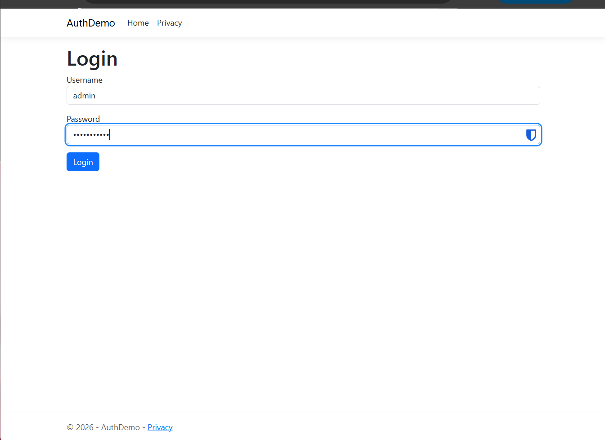
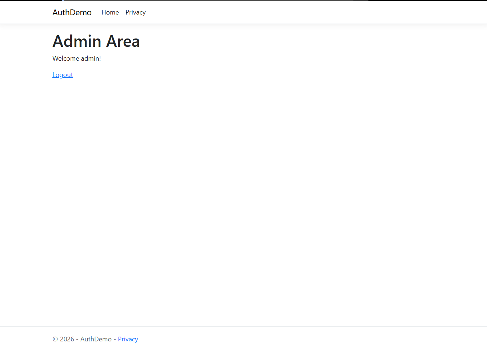

# AuthDemo — Authentication & Authorization

## Overview

This ASP.NET Core Razor Pages application demonstrates cookie-based authentication and authorization. Users can log in, access a protected admin page, and log out.

## Features

- Login with username and password

- SHA-256 password hashing for assignment demonstration

- User credentials stored in `data/users.json`

- Cookie-based authentication

- Protected admin page using `[Authorize]`

- Logout functionality

## Login Credentials

- **Username:** `admin`

- **Password:** `Password123`

## Running the Application

1. Clone the repository.

2. Open the project directory.

3. Run `dotnet run`.

4. Open the localhost URL displayed in the terminal.

5. Navigate to `/Account/Login`.

## Screenshots

### Login Page

### Protected Admin Page

## Technologies

- ASP.NET Core Razor Pages

- C#

- .NET

- JSON

- Cookie Authentication

## Assignment

Module 10.3 — Authentication & Authorization

